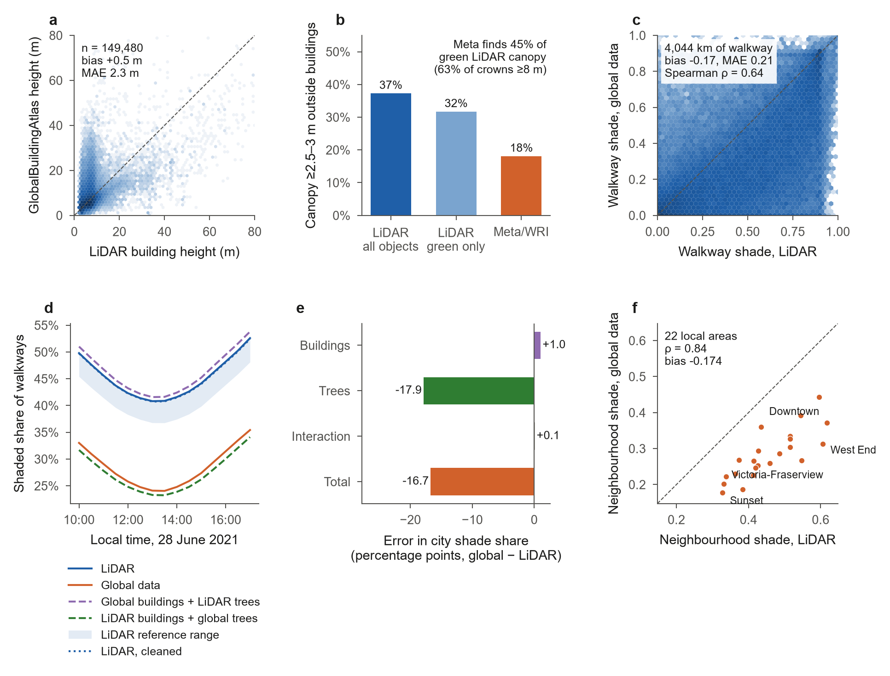
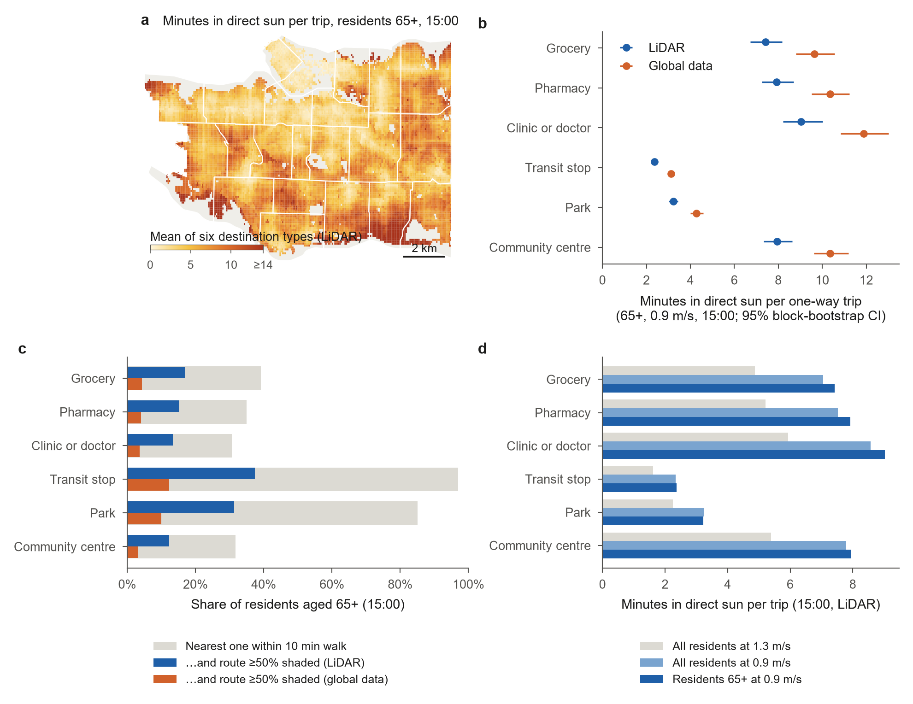

# Shade on the way

[](https://github.com/YaniceZ/shade-equity/actions/workflows/tests.yml)

How much of an older resident's walk to a grocery store, pharmacy, clinic, bus stop, park or community centre is in direct sun, and can open global data answer that question in cities without LiDAR? This repository models walkway shade in Vancouver on 28 June 2021, the peak of the Pacific Northwest heat dome, twice: once with airborne LiDAR and once with open global datasets, and routes every resident to the nearest essential destination.

**Manuscript:** [paper/manuscript.md](paper/manuscript.md) (draft, not peer reviewed) · **Figures:** [docs/figures](docs/figures) (vector PDF and PNG) · **Interactive map:** [docs/index.html](docs/index.html)

## Summary

- **Open global data miss most of the shade.** With LiDAR, 45.2% of the city's 4,044 km of walkways were shaded between 10:00 and 17:00. GlobalBuildingAtlas building heights with the Meta/WRI 1 m canopy height map gave 28.5% (bias −16.7 percentage points, walkway-level R² 0.12).
- **Trees, not buildings, cause the error.** Swapping one layer at a time: global trees −17.9 points, global buildings +1.0. GlobalBuildingAtlas underestimates towers over 30 m by 18.7 m on average, but towers are few. The Meta/WRI map finds 45% of green LiDAR canopy (63% of crowns ≥8 m).
- **Rankings survive; thresholds do not.** Neighbourhood rankings agree (Spearman ρ = 0.84 across 22 local areas; the five least-shaded areas are the same set), but threshold indicators are biased several-fold: 16.8% of residents aged 65+ have a grocery store within a 10-minute walk on a route that is at least half shaded at 15:00 by LiDAR, 4.4% by global data.
- **Older adults are not on shadier or sunnier routes than others; they are slower and a little farther away.** Using 2021 Census counts by dissemination area, the 65+ and all-resident route shade differs by less than half a percentage point. Walking at 0.9 instead of 1.3 m/s adds 44% more time in the sun; where older adults live adds about 5% more for clinics, pharmacies and groceries. Of older adults with a destination within 10 minutes, 56–63% face a mostly sunny route at 15:00.
- **Placement matters for street trees (simulation).** 50 km of new street trees on the sunny walkways older adults use most cut their sun exposure by 10.6%; the same length on the sunniest walkways cut it by 1.5%. Shade-seeking routes cut sun exposure by 21% for 1.1% extra distance.
- **WorldPop cannot show where older adults live within Vancouver.** Its 2025 age layers give every 100 m cell the same 65+ share (18.3%).





## Robustness

| Check | LiDAR shade | Global shade |
|---|---|---|
| Baseline (10% crown transmissivity, crown base at 25% of height) | 45.2% | 28.5% |
| 30% crown transmissivity | 36.2% | 23.5% |
| Solid crowns down to the ground | 45.6% | 28.7% |
| Street centrelines instead of sidewalks | 44.6% | 28.3% |
| 29 July 2021 instead of 28 June | 47.0% | 30.6% |
| LiDAR cleaned by shape and texture (thin objects removed, smooth objects made opaque) | 45.1% | 28.5% |
| LiDAR green canopy only (Sentinel-2 NDVI ≥ 0.3), a lower bound | 41.0% | 28.5% |

87% of tall LiDAR objects outside building footprints fall in 10 m Sentinel-2 cells with NDVI ≥ 0.3. By height texture, 68% of the rest look like tree crowns (crowns over pavement lower the NDVI of a 10 m cell), 23% like structures missing from footprints and 9% like poles or wires. City of Vancouver data agree: 29% of the smooth objects lie inside the city's own 2015 building footprints, against 3% of green canopy. Against the green-only lower bound the global model still underestimates walkway shade by 12.5 points (walkway MAE 0.17, Spearman ρ 0.70). An earlier version of this analysis used a Sentinel-2 scene that missed the eastern 39% of the city, which made the green-only bound look much lower (25.5%); this is corrected.

## Repository

| Path | Contents |
|---|---|
| `src/shadeq/config.py` | Study day, sun times, data sources, model parameters |
| `src/shadeq/data.py` | LiDAR (NRCan HRDEM), Overture and GlobalBuildingAtlas buildings, Meta/WRI canopy, WorldPop, 2021 Census (StatCan SDMX), OSM walk network and destinations, Sentinel-2 NDVI |
| `src/shadeq/surfaces.py` | Building and tree height layers on a 1 m grid, LiDAR reference variants, per-building height comparison |
| `src/shadeq/sun.py`, `shadow.py` | Solar position; ray-marched shadows from buildings and trees with crown transmissivity (Numba) |
| `src/shadeq/network.py` | Sidewalk sample points every 2 m, shade per walkway segment and hour |
| `src/shadeq/access.py` | Multi-source shortest paths from 100 m population cells to six destination types; sun-exposed length along each route; shade-seeking routes |
| `src/shadeq/analysis.py` | Validation, equity metrics, spatial block bootstrap, sensitivity |
| `src/shadeq/citycheck.py`, `lidar2022.py` | Checks of non-green LiDAR objects against City of Vancouver footprints and trees, and (optional, hand-downloaded tiles) the classified 2022 point cloud |
| `src/shadeq/scenario.py` | Street-tree planting scenarios |
| `src/shadeq/figures.py` | Figures 1–4 (183 mm, Arial 7 pt) |
| `src/shadeq/website.py`, `docs/index.html` | Map layers and the MapLibre project page |
| `results/` | `validation.json`, `equity.json`, `sensitivity.json`, `city_data_check.json`, CSV tables |

## Reproduce

```bash
python -m venv .venv && source .venv/bin/activate   # Windows: .venv\Scripts\activate
pip install -e ".[dev,data]"
shadeq all      # about 1.5 hours on a 32-thread machine, most of it data download
pytest -q
```

Files that must be placed in `data/raw/` by hand: the GlobalBuildingAtlas tile `w125_n50_w120_n45` (LoD1 JSON and both polygon parts, from Hugging Face), the Meta/WRI `tiles.geojson` index, WorldPop 2025 R2025A Canada files (total population and ages 65–90), and the Geofabrik British Columbia extract when the Overpass API is unavailable. The 1 m grid has 226 million cells; building the surfaces needs well over 8 GB of RAM (a 32 GB machine was used).

## Data and licences

| Data | Use | Licence |
|---|---|---|
| NRCan HRDEM, BC Lower Mainland 2016 LiDAR, 1 m DSM and DTM | Reference obstacles and terrain | Open Government Licence – Canada |
| GlobalBuildingAtlas (Zhu et al. 2025) | Global building heights | CC BY-NC 4.0 (non-commercial) |
| Meta/WRI 1 m global canopy height (Tolan et al. 2024) | Global tree heights | CC BY 4.0 |
| Overture Maps buildings, release 2026-11-18.0 | Footprints that split LiDAR heights into buildings and trees | ODbL / CDLA |
| OpenStreetMap via Geofabrik (17 Nov 2026) | Walk network, destinations | ODbL |
| WorldPop 2025 (R2025A), 100 m | Residential population | CC BY 4.0 |
| Statistics Canada, 2021 Census Profile and cartographic DA boundaries | Population aged 65+ | Statistics Canada Open Licence |
| Sentinel-2 L2A, 15 July 2018 (Planetary Computer) | NDVI check of LiDAR vegetation | Copernicus open licence |
| City of Vancouver local area boundaries | Neighbourhood summaries | Open Government Licence – Vancouver |
| City of Vancouver public trees and 2015 building footprints | Independent check of non-green LiDAR objects | Open Government Licence – Vancouver |

## Limitations

Shade is not thermal comfort: the model counts blocked direct sun only, not air temperature, humidity or long-wave radiation. The LiDAR is from 2016, the canopy imagery mostly 2018–2020 and the buildings and population 2021–2026, so some differences are real change. Routes are shortest paths to the nearest destination of each type; people do not always use the nearest store or the shortest path. The planting results are simulations under fixed crown size and spacing, not predictions.

## Licence

Code: MIT. Derived data follow the licences of their inputs; GlobalBuildingAtlas-derived layers are for non-commercial use.
